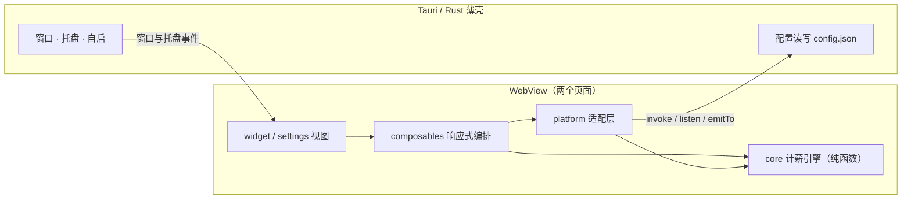

# 技术架构

> 项目总览与快速开始见 [README](README.md)，环境安装与打包见 [运行与打包手册](运行与打包手册.md)。

> 本文描述 **v0.1.0 已落地** 的代码架构：分层、依赖规则、运行时数据流、测试与构建。设计取舍见文末「架构决策记录」。

- 前端：Vue 3.5（Composition API + `<script setup>`）+ TypeScript 5.9 + Vite 6.4
- 外壳：Tauri 2（Rust）+ 系统 WebView2
- 测试：Vitest 3 + Vue Test Utils + 一套零依赖的计薪断言
- 打包：NSIS（当前用户安装，免管理员）

---

## 1. 一句话架构

**一个 Rust 薄壳 + 两个独立 Vue 页面 + 一个零依赖的纯 TypeScript 计薪引擎。**

WebView 只负责画界面和跑计薪纯函数；窗口、托盘、开机自启、配置落盘这些 WebView 做不到的事，全部收在 `src-tauri` 的薄壳里。



---

## 2. 分层与依赖规则

### 2.1 四层 + 一个外壳

| 层 | 目录 | 职责 | 允许依赖 |
| --- | --- | --- | --- |
| 视图层 | `src/widget`、`src/settings` | 渲染、交互、布局 | `composables`、`core` 的类型 |
| 编排层 | `src/composables` | 定时器、动画、订阅、派生状态 | `vue`、`core`、`platform` |
| 平台层 | `src/platform` | Tauri / 浏览器双实现的适配 | `@tauri-apps/api`、`core` |
| 领域层 | `src/core` | 计薪、日期、节假日、格式化 | **只有 TypeScript 本身** |
| 外壳 | `src-tauri` | 窗口、托盘、配置、自启 | Tauri / Rust 生态 |

### 2.2 五条硬约束

1. **`src/core` 不 import `vue`、不 import `@tauri-apps/api`、不碰 `window` / `document` / `localStorage`。**
   输入设置和时间，输出计划与金额，全部是纯函数——所以能脱离浏览器和桌面直接单测。
2. **`src/platform` 是唯一直接调用 `invoke` / `listen` / `emitTo` 的目录。**
   组件和 composable 不允许出现 Tauri API；浏览器预览时这一层自动降级到 `localStorage` + `BroadcastChannel`。
3. **`src/composables` 管响应式编排，不管 DOM。**
   定时器、`requestAnimationFrame`、事件订阅必须在 `onUnmounted` 里清理。
4. **`src/widget` 与 `src/settings` 只做视图。**
   不写计薪公式、不直接调 Rust 命令、不保存跨页面共享状态。
5. **依赖方向只能向内**：`views → composables → core`，`composables → platform → core`。
   禁止 `core → vue`、`core → platform`、`platform → views`。

---

## 3. 目录结构

```text
work_afk/
├─ index.html                  悬浮窗入口（Vite 多页）
├─ settings.html               设置页入口
├─ src/
│  ├─ core/                    领域层：纯 TS
│  │  ├─ pay.ts                计薪引擎：日薪、时薪、已赚、进度、状态机
│  │  ├─ date.ts               本地日期时间工具
│  │  ├─ holidays.ts           2025–2026 法定节假日表
│  │  ├─ format.ts             金额 / 百分比 / 时长格式化
│  │  └─ types.ts              Settings / AppConfig / DayPlan / Phase
│  ├─ platform/                适配层
│  │  ├─ config.ts             loadConfig / saveSettings（Tauri + localStorage 双实现）
│  │  ├─ events.ts             Tauri event + BroadcastChannel 跨窗口同步
│  │  ├─ window.ts             当前窗口显示 / 隐藏 / 置顶 / 打开设置
│  │  └─ autostart.ts          开机自启命令封装
│  ├─ composables/
│  │  ├─ useSettings.ts        设置状态、校验、保存、订阅
│  │  ├─ useDayPlan.ts         按当前时间与设置派生 DayPlan
│  │  ├─ useNow.ts             1Hz 当前时间（隐藏即暂停）
│  │  ├─ useRollingValue.ts    rAF 平滑滚动金额
│  │  ├─ useWindowChrome.ts    置顶 / 隐藏 / 打开设置
│  │  └─ useAutostart.ts       开机自启
│  ├─ widget/                  悬浮窗视图 + 子组件 + SVG 图标
│  ├─ settings/                设置页视图 + 表单组件
│  └─ styles/                  tokens / base / widget / settings 四份样式
├─ tests/
│  ├─ unit/pay.spec.ts         94 条计薪断言
│  └─ component/               WidgetApp / SettingsApp 组件测试
├─ src-tauri/
│  ├─ src/main.rs              二进制入口，只调用 lib
│  ├─ src/lib.rs               应用组装、命令、托盘、窗口事件、自启
│  ├─ capabilities/default.json 最小权限声明
│  └─ tauri.conf.json          两个窗口、NSIS、图标
├─ scripts/                    自检、变异测试、截图、布局核查、环境安装
└─ docs/                       本目录
```

---

## 4. 领域层：计薪引擎

`src/core/pay.ts` 是项目的核心资产，不依赖任何框架，任何时刻可以单独跑。

### 4.1 对外 API

| 函数 | 作用 |
| --- | --- |
| `getMonthInfo(date, settings)` | 当月计薪天数、日薪、休息日数 |
| `getDayKind(date, settings)` | 当天是 `workday` / `holiday` / `rest`，节假日附带名称 |
| `getDayPlan(now, settings)` | 当天完整计划：状态、已赚、进度、剩余秒数、时薪、每秒收入 |
| `getMonthEarned(now, settings, todayEarned)` | 本月累计（含今天已赚） |
| `validateSettings(settings)` | 返回非法项文案数组，供设置页红字提示 |
| `describeMonth(month, settings)` | 设置页「本月计薪 N 天」说明文案 |

### 4.2 计薪公式

```text
计薪天数 = 当月工作日天数 + 落在休息日的法定节假日天数
日薪     = 月薪 ÷ 计薪天数
每秒收入 = 日薪 ÷ 当日有效工作秒数
今日已赚 = 已工作的有效秒数 × 每秒收入
有效工作秒数 = (下班 − 上班) − 午休时长
```

- 周末不计薪；**法定节假日全天照发**（`holiday` 优先级高于 `rest`）。
- 午休不计入工作时长，午休期间金额冻结。
- 金额向下取整，不会出现「还没赚到就先显示」。
- 计薪天数可在设置里手动覆盖（如 21.75）。

### 4.3 状态机

`Phase` 六态：`before` → `working` → `lunch` → `after`，外加 `holiday`、`rest` 两个整日状态。

| Phase | 触发条件 | 金额 |
| --- | --- | --- |
| `before` | 今天要上班，当前 < 上班时间 | 0，显示距开工倒计时 |
| `working` | 上班时间 ≤ 当前 < 下班时间（不在午休） | 逐秒增长 |
| `lunch` | 午休开关打开且落在午休区间 | 冻结在午休起点 |
| `after` | 当前 ≥ 下班时间 | 定格整日工资 |
| `holiday` | 当天是法定节假日（含落在周末的） | 整日工资（躺赚） |
| `rest` | 非工作日且非法定节假日 | 0 |

边界被明确固定：`18:00:00` 整点属于 `after`（用 `>=`），午休区间左闭右开。这类边界全部写了断言。

---

## 5. 平台适配层

`src/platform` 是唯一的「环境差异吸收层」，同一个函数在桌面和浏览器里行为不同但签名一致。

| 模块 | 桌面（Tauri） | 浏览器预览 |
| --- | --- | --- |
| `config.ts` | `invoke("load_config")` / `invoke("save_settings")` | `localStorage` |
| `events.ts` | `emitTo` / `listen` | `BroadcastChannel` |
| `window.ts` | 当前窗口 show / hide / setAlwaysOnTop / `invoke("open_settings")` | no-op |
| `autostart.ts` | `invoke("set_autostart")` | no-op |

两个细节：

- `isTauri` 通过 `"__TAURI_INTERNALS__" in window` 判定，浏览器预览不会误调命令。
- `normalizeSettings()` 是所有外部数据的唯一入口：字段缺失、类型不对、数组越界、小数位不在 0–3、透明度越界，全部在这里洗成合法值。**配置损坏不会崩界面**，这是「手改坏 JSON 也能启动」的实现点。

---

## 6. 响应式编排层

### 6.1 六个 composable

| Composable | 职责 |
| --- | --- |
| `useSettings` | 窗口内共享设置状态，`load / patch / save / reset`，可选订阅跨窗口更新 |
| `useDayPlan` | `computed` 派生 `DayPlan`，视图只读结果 |
| `useNow` | 1Hz 当前时间；`document.hidden` 时暂停定时器，恢复时立即对齐系统时钟 |
| `useRollingValue` | 把每秒跳一次的目标值插值成 60fps 连续滚动 |
| `useWindowChrome` | 置顶、隐藏到托盘、打开设置页 |
| `useAutostart` | 开机自启开关 |

### 6.2 「目标每秒算一次，画面每帧追一次」

```text
每 1 秒：plan = core.getDayPlan(new Date(), settings)   → 目标值
每 1 帧：display += (target - display) * easing         → 显示值（rAF）
```

`useRollingValue` 用 620ms 三次缓出（`1 - (1-p)^3`）追赶目标值，因此数字看起来是连续滚动而不是整秒硬跳。配套约束：

- 目标值每秒只算一次，不在帧里重复跑计薪规则；
- 系统开启「减少动画」时直接跳到目标值；
- 组件卸载时 `cancelAnimationFrame`；窗口隐藏时暂停定时器与动画；
- 休眠唤醒、跨天、切换时区都从当前时间**重算**，不累加、不补帧，避免漂移。

---

## 7. 视图层

- 两个 HTML 入口 = 两个 Tauri 窗口 = 两个独立 WebView，各自 `createApp()`，**不引入 Vue Router**。
  悬浮窗不需要路由，设置页也没有嵌套页面，多页构建比路由更省概念、也更容易分别控制窗口权限。
- 悬浮窗固定 380 × 212，无边框、透明、置顶、不进任务栏；布局用固定分区（品牌行 / 金额 / 状态行 / 进度条 / 三列统计）保证任意缩放下不裁切。
- 设置页 820 × 760，底部操作条固定，只有内容区滚动——这条是靠 `layout-audit.mjs` 实测保证的。
- 样式分四份：`tokens.css`（颜色 / 字号 / 圆角 / 间距变量）→ `base.css`（reset、透明窗口基础）→ `widget.css` / `settings.css`（页面专属）。两个页面共用同一套 token，避免各写一套颜色。

---

## 8. Rust 外壳

`src-tauri/src/main.rs` 只调用 `reborn_work_lib::run()`；`lib.rs` 承担应用组装与系统能力。

### 8.1 命令

| 命令 | 作用 |
| --- | --- |
| `load_config` | 读 `{ settings, window }`，文件缺失返回 `null`，解析失败返回错误 |
| `save_settings` | 只覆盖 `settings` 字段，保留 `window` |
| `open_settings` | 显示并聚焦设置窗口（前端不直接操作其它窗口） |
| `set_autostart` | 写 / 删 `HKCU\Software\Microsoft\Windows\CurrentVersion\Run` 的 `RebornWork` 值 |

### 8.2 窗口与托盘

- 悬浮窗 `closable: false`、`skipTaskbar: true`、`transparent: true`、`alwaysOnTop: true`、`visible: false`，首帧渲染后再 `show()`，避免白屏。
- 关闭窗口 = 隐藏到托盘；退出前进程把窗口位置写回配置。
- 托盘菜单四项：显示小组件 / 打开设置 / 收进托盘 / 退出；左键切换显示与隐藏。
- 托盘初始化失败只记录日志、不阻断启动——托盘不可用时程序仍然能跑。

### 8.3 配置

```json
{
  "settings": {
    "salary": 10000,
    "paydaysOverride": null,
    "workStart": "09:00",
    "workEnd": "18:00",
    "lunchEnabled": true,
    "lunchStart": "12:00",
    "lunchEnd": "13:00",
    "workdays": [1, 2, 3, 4, 5],
    "decimals": 2,
    "opacity": 0.94,
    "alwaysOnTop": true,
    "autostart": false,
    "effects": true
  },
  "window": { "x": 100, "y": 200 }
}
```

落盘位置 `%APPDATA%\com.rebornwork.app\config.json`（Tauri `app_data_dir`）。写入分工明确：**前端只写 `settings`，Rust 只写 `window`**，互不覆盖。

---

## 9. 测试与质量门禁

### 9.1 测试金字塔

| 层 | 资产 | 数量 |
| --- | --- | --- |
| 领域层 | `scripts/lib/checks.cjs` 断言集，同时被自检脚本和 Vitest 使用 | 94 条 |
| 变异测试 | `scripts/check-mutation.cjs`：故意改坏计薪规则，要求断言必须变红 | 5 组 |
| 组件层 | `tests/component/WidgetApp.spec.ts`、`SettingsApp.spec.ts` | 2 个文件 |
| 类型 | `vue-tsc --noEmit` | 全量 `.ts` / `.vue` |
| 视觉/布局 | `scripts/shot.mjs`（6 状态 + 设置页截图）、`scripts/measure.mjs`、`scripts/layout-audit.mjs` | 脚本断言 |

**变异测试**是这套测试的关键：它证明 94 条断言不是恒真。5 组变异分别是关闭节假日计薪、去掉整日工资、放宽下班边界、取消午休扣除、金额改四舍五入——每一组都必须被断言抓到。

### 9.2 一条命令

```bash
pnpm check   # vue-tsc → tsc(自检编译) → 94 断言 → 5 变异 → Vitest 96 项
```

质量门禁约定：改动计薪规则必须同步改断言；断言变红才允许提交。

---

## 10. 构建与打包

| 环节 | 做法 |
| --- | --- |
| 开发 | `pnpm dev`（Vite，端口 1420，`strictPort` 不自动换端口） |
| 构建 | `pnpm build` = `vue-tsc --noEmit` + Vite 多页构建（`index.html` / `settings.html`） |
| 桌面 | `pnpm tauri dev` / `pnpm tauri build` |
| 产物 | `reborn-work.exe`（单体，约 3.4 MB）+ NSIS 安装包（约 1.2 MB） |
| 安装 | `installMode: currentUser`，装到 `%LOCALAPPDATA%`，写 HKCU，不需要管理员 |

构建目标 `chrome105`，压缩 `esbuild`，不开 sourcemap。前端不引 UI 框架、不引状态库、不引路由，`node_modules` 体积和产物大小都保持在很小的量级。

---

## 11. 架构决策记录（ADR）

| # | 决策 | 理由 | 代价 |
| --- | --- | --- | --- |
| ADR-1 | Vue 3 而非 React 18 | `<script setup>` 让「状态 → 模板」绑定更直接；响应式依赖自动追踪，不必手写依赖数组；单文件组件里样式作用域天然隔离 | 生态与招聘面略窄于 React |
| ADR-2 | 不用 Vue Router，两个 HTML 入口 | 两个窗口本来就是两个独立 WebView，没有页面跳转需求；少一层 history / 懒加载 / 路由守卫 | 若设置页未来变成多级页面需要补路由 |
| ADR-3 | 不引 Pinia | 状态只有三类：持久配置、派生计划、动画显示值；一个模块级 `reactive` + `computed` 足够 | 状态规模变大后需要重新评估 |
| ADR-4 | `core` 零依赖纯函数 | 计薪是唯一「算错就完蛋」的部分，必须能脱离框架单测；94 条断言 + 5 变异全靠它 | 视图层需要自己拼装派生数据 |
| ADR-5 | Rust 只做薄壳 | WebView 做不到的才放进 Rust：窗口、托盘、注册表、文件；业务规则一律留在 TS | 单文件 `lib.rs` 变大，后续可按 config/tray/commands 拆分 |
| ADR-6 | 前端不直接操作其它窗口 | 跨窗口能力收在 Rust 命令里，capabilities 只开最小权限，避免给前端宽泛的窗口控制权 | 每次加系统能力都要加一个命令 |

---

## 12. 已知技术债与演进方向

| 项 | 现状 | 演进 |
| --- | --- | --- |
| 单实例（F-46） | 未做，重复启动会出现第二个托盘图标 | 命名互斥体或 `tauri-plugin-single-instance` |
| 节假日数据 | 只覆盖 2025–2026 | 数据表外置或改为可更新文件 |
| 调休 | 只按「法定当天」识别，调休上班的周末不算工作日 | 增加调休表 |
| 跨夜班次 | 不支持，下班必须晚于上班 | 计薪引擎按「跨天区间」重写 |
| 配置原子写 | 当前直接覆盖写 | 临时文件 + rename，降低断电损坏概率 |
| 配置 schema 校验 | `check-config.mjs` 依赖 `schema.tauri.app` | 缓存 schema 或本地校验 |
| Rust 拆分 | `lib.rs` 单文件 | 按 `config.rs` / `tray.rs` / `commands.rs` 拆 |
| Windows 交互验收 | 托盘 / 自启 / 位置记忆 / 关闭隐藏已实现，真机交互验收仍在进行 | 按 README 验收清单逐条勾 |

---

## 13. 怎么验证这套架构没被破坏

```bash
pnpm check          # 类型 + 94 断言 + 5 变异 + 96 Vitest
pnpm check:env      # 编译环境自检（Windows）
pnpm preview        # 起预览后另开终端
pnpm check:layout   # 820×760 设置页 / 380×212 悬浮窗布局断言
pnpm shot           # 用系统 Edge 重拍 6 张状态图 + 设置页截图
```

依赖方向是人工约定，没有被 lint 强制。改动时请自查：**`src/core` 里有没有冒出 `import ... from "vue"` 或 `invoke(`**——这是最容易破坏的一条。
